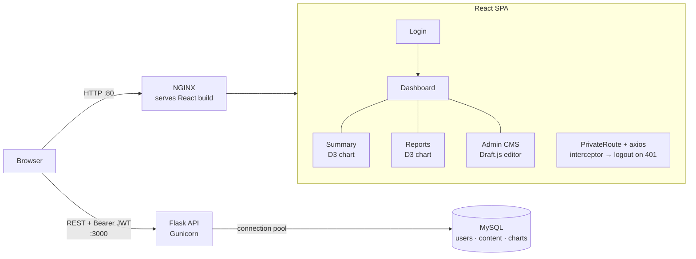

# GenAI Insights Dashboard

A full-stack **single-page application** that presents recent innovations in Generative AI through JWT-protected dashboard, summary and report pages with **D3.js** charts. The **React** frontend talks to a **Flask + MySQL** REST API, and a built-in admin console lets you edit page content and chart data without redeploying.


## Problem

Build a production-style SPA with a fully **decoupled frontend and backend**: login-gated pages, charts loaded asynchronously from the database over authenticated HTTP calls, accessible (WCAG-minded) markup, and a deployment where NGINX serves the frontend on port 80 and the API runs on port 3000. On top of the brief, I added an **admin CMS** so content and chart data live in MySQL instead of being hardcoded.

## Architecture



## Tech stack

| Layer | Tools |
|---|---|
| Frontend | React 18, React Router, Axios (with auth interceptor), D3.js 7, Draft.js / react-draft-wysiwyg, DOMPurify, react-toastify |
| Backend | Python, Flask, Flask-JWT-Extended, Flask-CORS, mysql-connector (connection pooling), Gunicorn |
| Database | MySQL: `users`, `content` (rich text + rendered HTML), `charts` (JSON chart data) |
| Deployment | NGINX (frontend on :80), backend on :3000, Linux server |

## Features

- **JWT authentication**: login issues a 1-hour access token, `PrivateRoute` guards every page, and an Axios interceptor logs the user out on expiry.
- **Async charts**: the Summary and Reports pages fetch chart JSON from authenticated endpoints and render it with D3.
- **Admin CMS** (`/admin`): create, edit and delete page content (WYSIWYG, sanitized with DOMPurify) and chart datasets through `/admin/*` endpoints.
- **Security hygiene**: secrets come only from environment variables, passwords are stored as SHA-512 hashes, and the frontend sanitizes rendered HTML.

## My role

Individual project for *Network-Based Application Development* at UNC Charlotte. I designed and built the whole stack: the React SPA, the Flask API, the MySQL schema, the admin CMS, and the NGINX deployment.

## How to run

**Prerequisites:** Node 18+, Python 3.9+, MySQL 8.

```bash
# Backend (port 3000)
cd p75_backend
cp .env.example .env            # set JWT_SECRET_KEY and DB_* values
pip install -r requirements.txt
python app.py                   # creates the database and tables on first run

# Frontend (port 3000 is taken, so CRA will offer 3001)
cd ../p75_frontend
cp .env.example .env            # REACT_APP_API_URL=http://localhost:3000
npm ci
npm start
```

**Production:** `npm run build`, serve `p75_frontend/build/` with NGINX on port 80, and run the API with `gunicorn -b 0.0.0.0:3000 app:app`.

> On first start the backend seeds a demo user, `poojitha`, whose password is the same word; the assignment brief required those credentials. Change it for any real deployment.

## Results

- Fully decoupled SPA: every page's data comes from the API over JWT-authenticated calls.
- Content and charts are editable at runtime through the admin console, with no code changes or redeploys.
- Deployed on a single Linux server (NGINX on :80, Flask API on :3000) per the course requirements.

## Screenshots

_Coming soon: login, dashboard, summary chart, reports chart and admin console._

## Repo structure

```
.
├── p75_backend/
│   ├── app.py              # Flask API: auth, pages, admin CRUD, DB init
│   ├── requirements.txt
│   └── .env.example
└── p75_frontend/
    ├── src/
    │   ├── config.js       # API_URL from REACT_APP_API_URL
    │   ├── axiosInterceptor.js
    │   └── components/     # Login, Dashboard, Summary, Reports, Admin, Navbar, PrivateRoute…
    ├── public/
    └── package.json
```
